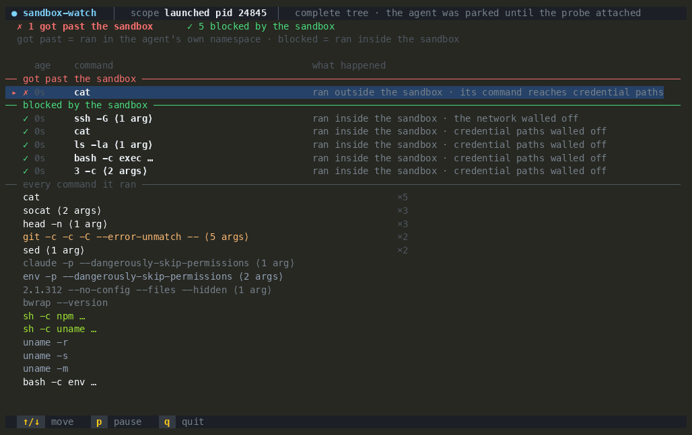

<!-- yeet:user-friendly-title: Watch an AI agent's sandbox from the kernel -->
# `sandbox-watch`

> **Did the agent's sandbox actually hold?** The question a transcript can't answer, read from the kernel.

<p align="center">
  <a href="#requirements"></a>
  <a href="https://yeet.cx/docs/?utm_source=github&utm_medium=readme&utm_campaign=sandbox-watch&utm_content=badge"></a>
  <a href="#the-bpf-side"></a>
  <a href="#what-youre-looking-at"></a>
  <a href="#license"></a>
  <a href="https://discord.gg/JxVseaAVAU"></a>
</p>

<p align="center">
  
</p>

**`sandbox-watch` is an eBPF agent sandbox monitor for Linux: it follows a sandboxed coding agent from the kernel and tells you which of its commands ran inside the sandbox and which ran outside it, where nothing was walled off.**

## Quick start

```sh
curl -fsSL https://yeet.cx | sh                                   # install yeet, once
yeet run gh:yeet-src/sandbox-watch --tty -- --pid $(pgrep -n claude)   # watch a running agent
```

A coding agent's sandbox unshares the network namespace for each command it confines. Both Claude Code and Codex do this: Claude Code wraps each command with `bubblewrap`, and Codex does the same through its `codex-linux-sandbox` helper, which is also `bubblewrap` plus a seccomp filter. `sandbox-watch` stamps every command the agent runs with the net namespace it ran in and compares that to the agent's own: a command whose namespace differs ran inside the sandbox, one whose namespace matches ran outside it, in the agent's own namespace, where a credential path and the network are not walled off. A second probe on the file-open path upgrades the outside case to a kernel fact when a credential read landed on the real file. The comparison is agent-agnostic (it keys on the namespace, not the agent's name); Claude Code and Codex are the two verified today.

The thing a transcript gives you is what the agent says it did. That is the wrong source for a security question, because the interesting case is the command the agent reran outside the sandbox after the sandboxed one failed, and the transcript narrates that as one line if it mentions it at all. `sandbox-watch` reads the exec and the file open where they happen, below the agent, so it does not depend on the agent being forthcoming.

### Which agents

`sandbox-watch` works with any coding agent whose sandbox gives each confined command its own network namespace, which is what makes the inside and outside of the boundary observable from the kernel. It does not hard-code an agent: the comparison is purely about the namespace. Verified so far:

| agent | sandbox | what `sandbox-watch` sees |
| --- | --- | --- |
| Claude Code | `bubblewrap`, with `tmpfs`/`/dev/null` stand-ins over denied paths and a default unsandboxed-retry | both sides, and `[verified]` on a real credential read that ran outside the sandbox |
| Codex | `codex-linux-sandbox`: `bubblewrap` plus a seccomp filter, read-only or workspace-write | both sides, from the same `bwrap` network unshare |

One real difference to know, and the reason the two rows above end differently: Claude Code's sandbox denies a read by mounting an empty stand-in over the path, so a denied credential read returns an empty file, and a read of the real file only happens once a command runs outside the sandbox, which is what `[verified]` catches. Codex's default sandboxes (`read-only`, `workspace-write`) restrict writes and the network but leave reads open, so a sandboxed Codex command reads the real credential file from inside its own namespace. `sandbox-watch` reports that as "its command reaches credential paths" (the argv inference), and reserves `[verified]` for a read that landed on a real file outside the sandbox. The namespace split is the same for both; the credential-read layer is tuned to the `bubblewrap` stand-in, so it confirms the escape-and-reread case rather than Codex's read-from-inside case.

Agents that confine without a per-command network namespace (a pure-Landlock or pure-seccomp sandbox with no `unshare`, a container, a VM) will not light up the two sides; see [What it can't see](#what-it-cant-see).

> [!TIP]
> **It watches the syscall boundary, not the agent.** The agent is not configured, not wrapped, and not asked to cooperate. Three `sched` tracepoints see every process it forks and execs; an `fentry` on `security_file_open` sees which file each open resolved to, before the read returns. Nothing in the agent can turn this off, because it runs in the kernel.

## Contents

**Run it** — [Which agents](#which-agents) · [Get started](#get-started) · [Have an agent set it up](#have-an-agent-set-it-up) · [Reading it without a TTY](#reading-it-without-a-tty)

**Understand it** — [A 60-second primer](#a-60-second-primer-on-agent-sandboxes) · [Questions this tool answers](#questions-this-tool-answers) · [What you're looking at](#what-youre-looking-at) · [How it works](#how-it-works) · [What it can't see](#what-it-cant-see)

**Reference** — [Requirements](#requirements) · [FAQ](#faq) · [License](#license)

**Contribute** — [Building from source](#building-from-source) · [Testing across kernels](#testing-across-kernels) · [Try it without an agent](#try-it-without-an-agent)

## Get started

```sh
curl -fsSL https://yeet.cx | sh
make               # compile bin/probe.bpf.o + bundle the JS (toolchain auto-fetched)
yeet run . --tty   # unscoped: seeds the host and waits for a --pid or a launch
```
[Manual install guide](https://yeet.cx/docs/install/manual-installation?utm_source=github&utm_medium=readme&utm_campaign=sandbox-watch) | Linux only

That is the whole install. `yeet run` clones the repo into its own cache, runs `make` to compile `bin/probe.bpf.o` and bundle the JS, then starts the script; the BPF toolchain is fetched automatically, so there is no clang, bpftool or `linux-tools` to install first. `yeet-src` is a trusted source for the runtime, so the build runs without a consent prompt.

There are two ways to scope the watch. Attach mode is one line against a running agent; launch mode starts the agent under the probe so the tree is complete from its first command.

```sh
yeet run gh:yeet-src/sandbox-watch --tty -- --pid $(pgrep -n claude)   # attach to a running agent's pid subtree
yeet run gh:yeet-src/sandbox-watch --tty -- --container my-agent       # attach to a running container
```

`--tty` goes before the `--` because it belongs to `yeet run` (it gives the script a terminal to draw in; without it the TUI has nothing to paint), and the script's own flags go after. Getting that split wrong is the most common first-run mistake.

Attach mode sees the agent and everything it starts from the moment it attaches, plus the children that already existed when it attached (it seeds them from the process table). What it cannot see is a command that exited before it got there.

Launch mode closes that gap: it starts the agent stopped, attaches, then releases it, so nothing forks unobserved and the sandbox setup itself is captured. It needs the `bin/sandbox-watch` wrapper, because a yeet isolate cannot spawn a process, so clone the repo to use it:

```sh
git clone https://github.com/yeet-src/sandbox-watch && cd sandbox-watch && make
./bin/sandbox-watch -- claude      # start claude under the probe, tree complete from byte 0
./bin/sandbox-watch -- codex       # same, for Codex
```

It runs until `q` or `Ctrl-C`, reflows on resize, and needs a real terminal, so do not pipe or redirect it. For the text form an agent or a CI job can read, see [Reading it without a TTY](#reading-it-without-a-tty).

| flag | default | meaning |
| --- | --- | --- |
| `--pid=<n>` | unscoped | attach to a running agent and watch its process subtree |
| `--container=<name\|id>` | unscoped | scope to a running container; a wrong name lists what is running |
| `bin/sandbox-watch -- <cmd …>` | none | launch mode (the wrapper): start `<cmd>` stopped, attach, then release it for the complete tree |

With no scope it seeds the whole host and says so, because judging a sandbox needs one agent to compare against; it will tell you to pass `--pid` or launch with `--`.

## Have an agent set it up

Paste this to a coding agent on the box:

```text
Set up sandbox-watch from https://github.com/yeet-src/sandbox-watch on this machine.

1. Check `make` is installed (`command -v make`). yeet shells out to it to
   compile the eBPF object, and a fresh box may not have it. If it is missing,
   install a C toolchain first: `sudo apt-get install -y build-essential` on
   Debian or Ubuntu, the equivalent elsewhere.
2. Clone it (or git pull if it already exists), then read AGENTS.md.
3. Run `make` to compile the BPF object and bundle the JS. If the toolchain
   download fails, say so instead of guessing.
4. Confirm it actually watches something, not just that it built. In one
   terminal, start a throwaway shell that reaches for a credential path, e.g.
   `bash -c 'sleep 2; ls -la ~/.ssh'`, note its pid, and run
   `yeet run . --tty -- --pid <that-pid>`. A row for `ls` should appear under
   "every command it ran".
5. Then run the headless check: `yeet run src/probes/capture.js -- <pid> 10`
   and confirm it prints a verdict block and exits.

"It compiled" is not the same as "it works". Do not report success until a
command you ran shows up in the output.
```

Prefer to drive it yourself? Everything the prompt does is in [Get started](#get-started) and [Reading it without a TTY](#reading-it-without-a-tty).

## A 60-second primer on agent sandboxes

A coding-agent sandbox is not a container and not a VM. It is a per-command wrapper. When Claude Code runs a shell command under its sandbox, it launches that command inside a fresh set of Linux namespaces built with `bubblewrap`: a new network namespace with no route out (egress is forced through a local proxy), and bind mounts that replace denied paths. The important and surprising part is how a denied read is denied: the sandbox does not return "permission denied". It mounts an empty `tmpfs` directory over `~/.ssh`, or `/dev/null` over a file, and lets the open succeed against the stand-in. So from inside, a denied credential read returns an empty file, not an error.

Two settings decide whether that boundary holds. `credentials.files` controls which paths get a stand-in; with the defaults, reads of the whole machine are allowed and your credential files are readable unless you deny them by name. `allowUnsandboxedCommands` controls what happens when a sandboxed command fails: left at its default, the agent may rerun the command outside the sandbox, in its own namespace, where nothing is walled off. That reran command is the one worth watching, and it is exactly the one a transcript is least likely to flag.

Which means the kernel has a cleaner answer than the agent does to "did the sandbox hold": not an errno, but which namespace each command ran in, and which filesystem each open landed on.

## Questions this tool answers

- **I'm running Claude Code with its sandbox on. How do I actually verify the sandbox is containing it, rather than trusting that it is?** Watch it from the kernel. `sandbox-watch` stamps every command with its net namespace and shows you the two sides: commands that ran inside the sandbox, and commands that ran in the agent's own namespace where nothing was walled off. See [What you're looking at](#what-youre-looking-at).
- **Does turning on `/sandbox` with the default config keep everything contained?** No, and this is the whole reason the tool exists. The default read scope is the entire machine, and the default unsandboxed-retry setting lets a command that fails inside the sandbox rerun outside it. A command reran that way opens the real file. The primer explains both settings; the got-past panel shows it happening.
- **An agent read a credential file. How do I prove whether it hit the real file or the sandbox's empty stand-in?** The `fentry/security_file_open` probe reads the superblock magic of the opened inode's filesystem. A real file is on a disk filesystem; a stand-in is `tmpfs` or `/dev/null`. A real read outside the sandbox is tagged `[verified]` and the file is named. See [The BPF side](#the-bpf-side).
- **I hand coding agents to developers with a sandbox policy. How do I audit whether that policy is doing anything on a real box?** Launch the agent under `sandbox-watch` and run a task that reaches for a secret or the network. Every sensitive command lands on the blocked side or the got-past side, so the policy's effect is a thing you can see rather than assume.
- **Can I watch this on a server over SSH, with nothing installed in the agent and no container?** Yes. It is a terminal tool: one `yeet run`, no agent configuration, no wrapper, no sidecar. The yeet daemon handles the privileged BPF load; the script itself is unprivileged.
- **Is this a replacement for a sandbox, like gVisor, a container, or Claude Code's own sandbox?** No. `sandbox-watch` is a watcher, not a cage: it reports what crossed the boundary, it does not stop, hold, or modify anything. It makes the boundary you already have legible. For refusal rather than a record, see the next answer.
- **When should I reach for enforcement instead of observation?** When you want the escape prevented, not just recorded. [`agent-lock`](https://github.com/yeet-src/agent-lock) confines an agent and everything it spawns to one directory with a BPF LSM program and refuses the reads that leave it, on kernels built with `CONFIG_BPF_LSM`. Use `sandbox-watch` to see what a sandbox is doing; use `agent-lock` to make a boundary that cannot be reran around.
- **I just want to know every command the agent ran, sandbox aside. Is that here too?** Yes, in the feed under the verdict, but [`exectop`](https://github.com/yeet-src/exectop) is the dedicated tool for that: the full folded exec stream with the unusual ranked on top, no sandbox framing.

## What you're looking at

One screen, read top to bottom. The default-config escape from the GIF above:

```
 ● sandbox-watch   ▏  scope launched pid 24845  ▏  complete tree · the agent was parked until the probe attached
 ✗ 3 got past the sandbox     ✓ 6 blocked by the sandbox
 got past = ran in the agent's own namespace · blocked = ran inside the sandbox
── got past the sandbox ─────────────────────────────────────────────────────────
   age  command                      what happened
 ✗ 41s  ssh -T -o -o ⟨3 args⟩        ran outside the sandbox · opened your real /home/dev/.ssh/known_hosts  [verified]
 ✗ 50s  cat                          ran outside the sandbox · its command reaches credential paths
── blocked by the sandbox ───────────────────────────────────────────────────────
 ✓ 48s  ssh -T -o -o ⟨3 args⟩        ran inside the sandbox · the network walled off
 ✓ 48s  cat                          ran inside the sandbox · credential paths walled off
 ✓ 50s  ls -la ⟨1 arg⟩               ran inside the sandbox · credential paths walled off
── every command it ran ─────────────────────────────────────────────────────────
   cat                                                           ×6
   socat ⟨2 args⟩                                                ×5
   bwrap --new-session --die-with-parent --unshare-net --bind … ×2
   ↑/↓ move    p pause    q quit
```

The title rail carries the scope and, in launch mode, that the tree is complete because the agent was parked until the probe attached. The headline turns red the instant anything is in the got-past panel and stays green (`✓ the sandbox held`) while it is empty, so one glance says whether the sandbox held. Below it, three panels: the two sides of the boundary, then the full exec feed for context.

A got-past row is argv-inferred ("its command reaches credential paths") unless the file-open probe confirmed a real read, in which case it is tagged `[verified]` and names the file. The blocked side states only the namespace fact and never claims to have verified the block, for a reason in [What it can't see](#what-it-cant-see).

| column | meaning |
| --- | --- |
| `✗` / `✓` | got past (ran outside) or blocked (ran inside), per the net namespace |
| `age` | wall-clock time since the command last ran, counted from arrival, not the kernel clock |
| `command` | the exec, folded by kind: paths elided, repetition collapsed, subcommand kept |
| `what happened` | the verdict: `opened your real <file> [verified]`, `its command reaches <X>`, or `<X> walled off` |
| `×N` (feed) | how many times this kind of command ran |

Keys: `↑`/`↓` or `j`/`k` to move the cursor over the verdict list, `p` to pause the stream (so a fast run holds still), `q` to quit. A `dropped N` warning appears in the title rail if a fork storm outran the ring buffer, so the counts on screen are a floor rather than a total.

## Reading it without a TTY

A TUI is the one output an agent, a CI job, or an SSH-in-a-hurry cannot read. The headless capture is the text form:

```sh
yeet run src/probes/capture.js -- <agent-pid> [seconds]
```

It seeds the agent root, runs the real probe through the same aggregation the TUI uses, aggregates for `[seconds]` (default 30), then prints the verdict as text and exits. The output is the two sides with the same `[verified]` tags, suitable for a log or a diff:

```
-- sandbox (agent netns 4026531840) --
  ✗ 2 got past the sandbox
    ✗ ssh -T -o -o ⟨3 args⟩    ran outside the sandbox · opened your real /home/dev/.ssh/known_hosts  [verified]
  ✓ 6 blocked by the sandbox
    ✓ ssh -T -o -o ⟨3 args⟩    ran inside the sandbox · the network walled off
```

This is also what the "confirm it works" step in [Have an agent set it up](#have-an-agent-set-it-up) runs, and how the replay recordings for the web are produced.

## How it works

The layout is the yeet convention: `src/probes/` is the only BPF-aware code, `src/components/` is pure presentation that reads signals, and `src/lib/` is pure helpers with no kernel dependency. The `@/` alias resolves at bundle time.

```
bin/sandbox-watch       launch/attach wrapper (launch mode needs a shell; a yeet isolate can't spawn)
src/bpf/sandbox-watch.bpf.c   the eBPF program: four hooks, one loadable object
src/probes/probe.js     loads the object and binds the maps; shared by every probe
src/probes/watch.js     seeds the traced set, subscribes to both ring buffers, feeds the model
src/probes/capture.js   the headless text report (Reading it without a TTY)
src/lib/model.js        the fold + the sandbox verdict, pure JS over the exec stream
src/lib/argv.js         splits the raw NUL-separated argv blob the kernel copies up
src/lib/scope.js        container and pid resolution, the process table, descendants
src/components/         the sandbox view, title and footer rails
src/main.jsx            scope resolution, input, layout
```

### The BPF side

Four hooks maintain one idea: a set of tgids that belong to the watched agent, the execs they perform, and the files those execs open.

| program | hook | what it captures |
| --- | --- | --- |
| `on_fork` | `tracepoint/sched/sched_process_fork` | a watched task's child joins the traced set, one generation deeper; also learns the agent's net namespace from its first fork |
| `on_exec` | `tracepoint/sched/sched_process_exec` | if the task is in the set, emits the exec with its argv, ppid, and net namespace |
| `on_exit` | `tracepoint/sched/sched_process_exit` | the task leaves the set |
| `on_file_open` | `fentry/security_file_open` | for each in-scope open, the superblock magic of the opened inode's filesystem and the trailing path components |

The membership set is what makes "the agent" mean the whole process tree rather than one pid, which matters because the first thing a coding agent does under a sandbox is fork a wrapped shell command. It is seeded from userspace with the agent's pid and grown in-kernel at every fork.

The net namespace comparison is the core signal. `bwrap` unshares the network namespace for a sandboxed command, so a command whose netns differs from the agent's ran inside the sandbox, and one whose netns matches ran outside it. The agent's own namespace is learned in-kernel, not told: the first time the depth-0 root forks, which happens in the parent's context before it runs any command, so `current` is the root and its netns is read there.

The file-open hook is the credibility layer. A sandbox does not refuse a denied read; it mounts a stand-in over the path and lets the open succeed. So "was it blocked" is not an errno, it is which filesystem the opened inode lives on. `on_file_open` reads the superblock magic (`i_sb->s_magic`), and userspace names it: a real credential file is on a disk filesystem, a stand-in is `tmpfs` (`0x1021994`) or `/dev/null` (devtmpfs). That is how a real read outside the sandbox earns `[verified]` and a bare argv guess does not.

Maps: two `RINGBUF`s (32 MiB for execs, 4 MiB for the rarer opens), a `HASH` for the traced set keyed by a one-field struct, an `ARRAY` of counters so the UI can report dropped events, and two `PERCPU_ARRAY` scratch buffers because an exec record is ~1 KiB, far past the 512-byte BPF stack limit.

### The JS side

argv is copied up raw as a flat NUL-separated blob (`mm->arg_start..arg_end`) and split in JS, rather than walked in the kernel, because a bounded string scan is a verifier fight for no gain; the dev-loop rule is copy raw, parse up. `lib/model.js` folds repetition into one row per kind of command and runs the verdict: it pairs each command's namespace with whether its argv references a credential path or the network, and joins the file-open evidence by pid to upgrade a got-past row to `[verified]`.

<details>
<summary>Why the verdict wording is deliberately narrow</summary>

The kernel tells us an exec ran in the agent's own namespace, not *why*. An approved unsandboxed retry, a command the sandbox excludes, and a command you ran yourself all look identical from here, so nothing in `sandbox-watch` says "escaped". A command in the agent's namespace reads "ran outside the sandbox".

The agent process itself and launchers (`bwrap`, `unshare`, `sudo`, `env`) get no verdict of their own. The agent carries the user's prompt as argv, so `claude -p "...check ~/.ssh..."` would otherwise read as the agent reaching a credential path, when that is the prompt text, not a command it ran. A launcher carries the command it will run as its argv tail, so judging its full argv would attribute the child's sensitivity to the thing setting up the sandbox, the opposite of true. The child's own exec is what gets judged.

</details>

### Why a tracepoint and an fentry, not a BPF LSM hook

`on_file_open` attaches `fentry/security_file_open`, the same function a BPF LSM program would hook, but as an `fentry` observe-only probe. That is a deliberate choice: enforcement would need `lsm=bpf` on the kernel command line, which most machines do not have and which is a reboot to turn on. Observing needs only BTF and `fentry`, which is the common case, so `sandbox-watch` runs on a stock kernel without a reboot. The cost is that it watches and does not refuse; refusal is [`agent-lock`](https://github.com/yeet-src/agent-lock)'s job.

## Building from source

```sh
make          # build everything: the BPF object + the JS bundle
make bpf      # compile src/bpf/*.bpf.c into bin/probe.bpf.o only
make bundle   # bundle the JS entry with esbuild into src/index.jsx
make veristat # load the built object with veristat (a verifier check on this kernel)
make clean    # remove build artifacts
```

`make` is a build frontend over two independent compilers: clang for the BPF object, esbuild for the JS bundle. Both come from a static toolchain fetched into a per-machine cache, so there is no system clang, bpftool, Node or npm to install. `yeet run` invokes `make` automatically when running from a trusted remote source. The `@/` and `#/` import aliases are bundle-time only, which is why the BPF object is located at runtime with `import.meta.dirname` rather than an alias. `bin/probe.bpf.o` and `src/index.jsx` are gitignored build artifacts.

## Testing across kernels

A BPF program that loads on your laptop can be rejected by an older kernel's verifier, so correctness is a per-kernel fact. `make veristat` loads the built object and reports the verifier's verdict on the current kernel. The CI kernel matrix at `.github/workflows/kernel-matrix.yml` boots a range of kernels under little-vm-helper and runs the load against each, so a regression that only shows up on an older verifier is caught before it ships.

## Try it without an agent

You do not need a real coding agent to see a verdict. Any process that reaches for a credential path or the network, run partly inside a sandbox and partly outside it, exercises the same logic. The simplest demo is to start a throwaway shell that does both and attach to it by pid:

```sh
# terminal 1: a target that touches ~/.ssh and the network
bash -c 'sleep 2; ls -la ~/.ssh; ssh -T -o BatchMode=yes git@github.com'

# terminal 2: watch it (use the pid printed by the shell above)
yeet run . --tty -- --pid <that-pid>
```

The verdict logic is pure JS over the exec stream, which is why it can be tested against a recorded stream with no kernel at all; see `test/sandbox.test.mjs`.

## Requirements

> [!IMPORTANT]
> **Linux, with BTF and `fentry`.** The three `sched` tracepoints and the `fentry` on `security_file_open` need a kernel built with `CONFIG_DEBUG_INFO_BTF=y` and function-entry tracing, which is kernel 5.8 and newer and is the default on current Debian, Ubuntu, Fedora and Arch. CO-RE means the object is compiled once and relocates to the running kernel, so there is no per-kernel recompile. The yeet daemon handles the privileged BPF load; `yeet run` is unprivileged and never takes `sudo`. The net namespace comparison assumes the sandbox unshares the network namespace per command, which both `bubblewrap` (Claude Code) and `codex-linux-sandbox` (Codex) do; a sandbox that confines by some other mechanism, with no per-command network unshare, would not light up the two sides. See [Which agents](#which-agents).

## What it can't see

> [!NOTE]
> `sandbox-watch` observes. It tells you which side of the boundary each command ran on and whether a credential read hit a real file; it does not stop, hold, or modify anything. For refusal, see [`agent-lock`](https://github.com/yeet-src/agent-lock).

- **It cannot verify the blocked side.** A `bubblewrap` stand-in is a per-namespace mount, and `security_file_open` resolves the inode against the host mount namespace, so the superblock magic of a sandboxed open reads as the real filesystem even when the stand-in genuinely hid the file. A missing file in the stand-in also fails before the hook fires, so there is often no open at all. The blocked panel therefore states only the namespace fact ("ran inside the sandbox, credential paths walled off") and never claims a verified block. The got-past side, a real read in the host namespace, is the only thing earning `[verified]`.
- **It does not know intent.** The kernel sees the open and where it landed, not why. An approved unsandboxed retry, a command the sandbox deliberately excludes, and a command you ran yourself all look the same, which is why nothing here says "escaped".
- **It needs a single agent to compare against.** The verdict turns on only once the agent's namespace is learned and at least one command has run in a different one. Unscoped (whole host, no `--pid`), there is no agent to anchor the comparison, so it shows the exec feed without a verdict.
- **A fork storm can outrun the ring buffer.** The exec ring is 32 MiB, which held a measured 12-way fork storm, but a larger burst drops execs; the `dropped` counter reports what was lost rather than hiding it, so the counts are a floor.
- **argv is capped per exec.** The kernel copies a bounded window of the argv blob (1 KiB), so a very long command line is truncated; the row is marked when that happens.
- **One command run only inside, or only outside, is one-sided by nature.** The strongest story is a command that ran both ways (blocked inside, then reran outside), which is what the default-config escape produces.

For the full folded exec stream without the sandbox framing, [`exectop`](https://github.com/yeet-src/exectop) is the dedicated tool.

## FAQ

**The sandbox panels never appear, just the exec feed. Why?** The verdict needs a single agent to compare namespaces against, learned from its first fork. If you attached by pid after the agent had already forked its tree, or ran unscoped, the root's own fork was never seen. Use launch mode (`-- claude`), which parks the agent until the probe attaches.

**A got-past row says "its command reaches credential paths" without `[verified]`. Is it real?** It means the command's argv references a credential path and it ran outside the sandbox, but no file-open on a real filesystem was observed for it, so it is an argv inference rather than a confirmed read. `[verified]` is reserved for an open the kernel watched land on a real file.

**Why is the agent's own process not flagged, when its command line mentions `~/.ssh`?** The agent carries the user's prompt as argv (`claude -p "...check ~/.ssh..."`, and the same for `codex`), and the prompt text is not a command the agent ran. The agent process, by name (`claude`, `codex`, `aider`, `cursor`, `goose`, and others), and the launchers that set up the sandbox are excluded from the verdict by design; a tool call the agent spawns (a real `ls`, `cat`, `ssh`) is judged normally.

**Does it slow the agent down?** The in-kernel membership check drops every exec outside the traced tree before it reaches userspace, so the cost scales with the agent's own commands, not with everything on the box. File opens are filtered the same way.

**Can it watch an agent in a container?** Yes, with `--container <name>`; it resolves the container's root pid and seeds the subtree. A wrong name lists the running containers rather than failing silently.

## License

Dual BSD/GPL.

---

Built with [yeet](https://yeet.cx/docs/?utm_source=github&utm_medium=readme&utm_campaign=sandbox-watch&utm_content=footer), a JS runtime for writing eBPF programs on Linux machines. Join us on [discord](https://discord.gg/JxVseaAVAU).
